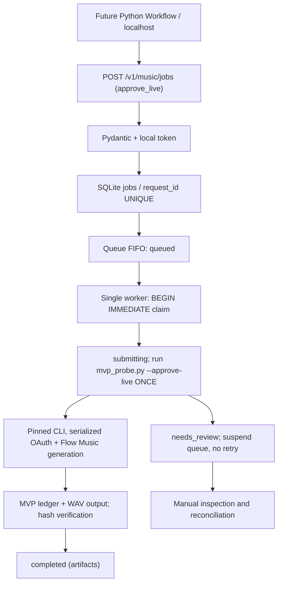

# API + fila FIFO durável — Windows MVP (v0.2)

**Integração real opcional e explicitamente autorizada**, sobre o `mvp_probe.py` que já gerou um WAV na validação local relatada em 14/10/2026. A API fica sempre local (`127.0.0.1:8765`). O serviço não usa Celery/Redis/Docker, nem modifica o Workflow principal. A API mock é o padrão.

## Codegraph


## Status
- `queued`: gravado antes de qualquer solicitação remota; permanecerá no banco após reinício e poderá ser executado no modo live autorizado.
- `submitting`: reservado atomicamente por um worker; se houver crash será convertido em `needs_review`, mesmo que o envio talvez não tenha ocorrido. Conservador para evitar duplicação.
- `completed`: o probe concluiu, gravou ledger e todos os arquivos foram revalidados com SHA256.
- `needs_review`: saída ambígua, erro, timeout ou interrupção; nenhuma repetição automática; fila bloqueada.
- `abandoned`: operador confirmou revisão da biblioteca e decidiu abandonar; não há reenvio.
- `auth_required`: provider diferente de mock mas serviço live não habilitado.

## API
- `GET /health`: servidor responde.
- `GET /v1/music/status`: provider, fila, worker, bloqueios.
- `GET /v1/music/queue`: totais e bloqueios.
- `GET /v1/music/jobs?limit=30`: últimos jobs; o retorno contém prompts e deve ficar estritamente protegido em localhost.
- `GET /v1/music/jobs/{id}`: estado e arquivos se concluído.
- `GET /v1/music/jobs/{id}/events`: eventos redigidos sem prompt ou tokens.
- `GET /v1/music/jobs/{id}/artifacts`: arquivos após conclusão.
- `POST /v1/music/jobs`: `request_id`, `prompt`, `model`, `duration_seconds`, `instrumental`, `output_format`, `approve_live`.
- `POST /v1/music/jobs/{id}/reconcile`: somente para `needs_review` e confirmação explícita; `resolution=abandoned|completed`. Marcar completed exige ledger concluído e hash válido; não reexecuta a tarefa.
- `POST /v1/music/queue/resume`: não produz música diretamente; remove bloqueio de processamento somente após nenhum job unresolved e nenhuma `generation.lock`.

As requisições exceto health precisam do header `X-Local-Token` de `data/local-token.txt`. **Nunca inclua esse token em logs enviados ao agente.**

## Ativação local
```powershell
# Opção 1 — desenvolvimento seguro (sem chamadas Google):
.\scripts\windows\start.ps1

# Opção 2 — fila real: operador confirma termos e autoriza uso de créditos:
.\scripts\windows\start.ps1 -EnableLive
```

Em outro terminal, sem mostrar o valor do token:
```powershell
$token = (Get-Content data/local-token.txt -Raw).Trim()
$headers = @{ 'X-Local-Token' = $token }
$body = @{
  request_id = 'natal-api-002'  # NOVO ID, nunca reutilize natal-mvp-001
  prompt = 'Trilha instrumental de Natal com piano e sinos'
  instrumental = $true
  model = 'Lyria 3.5'
  duration_seconds = 120
  output_format = 'wav'
  approve_live = $true
} | ConvertTo-Json

# SOMENTE se quiser consumir créditos:
Invoke-RestMethod 'http://127.0.0.1:8765/v1/music/jobs' -Method Post -Headers $headers -ContentType 'application/json' -Body $body

# Consultas seguras em seguida:
Invoke-RestMethod 'http://127.0.0.1:8765/v1/music/queue' -Headers $headers
```

**A submissão real pode consumir créditos.** Não dispare o exemplo automaticamente. A criação em SQLite é idempotente com o mesmo `request_id` e payload; payload diferente retorna 409. A proteção não implica que a API não documentada do Google aceite uma chave idempotente. O worker chama o probe uma única vez. Se houver erro após tentativa, paralisa toda a fila; o operador deve verificar o áudio/biblioteca antes de usar `reconcile` ou remover qualquer lock órfão. Nunca apague locks durante processo ativo.

A fila limita a 25 pendentes, usa um worker sem concorrência e faz polling local a cada ~0,75s. Não aciona chamadas automáticas para consultar créditos. As duas validações antes de ativar são: conta autenticada no Windows e termos de uso compatíveis com a forma de integração. Não usar proxies, rotação de contas ou bypass de proteções.

## Limites conhecidos
- O `mvp_probe.py` ainda só recebe a geração por prompt, modelo, instrumental, formato e duração; **lyrics personalizadas não são suportadas pela fila live** e retornam 422 em vez de serem ignoradas.
- O ledger originalmente não registrava `provider_job_id`/SSE incremental, então a recuperação após erro ambíguo é manual. Uma melhoria futura deve persistir esse ID antes de aguardar áudio, sem provocar novo POST.
- FFprobe e qualidade musical ainda precisam de validação antes do Workflow consumir WAV; a fila atual revalida caminho, tamanho e SHA-256.
- Prompts constam do SQLite local para recuperar jobs; proteger `data/` com NTFS ACL em máquinas compartilhadas.
- O servidor FastAPI executa um worker interno no `lifespan`, mantido por um único processo Windows. Não inicie vários Uvicorn workers. <Link> não integra o Workflow automaticamente; consumo depende de comando explícito.
