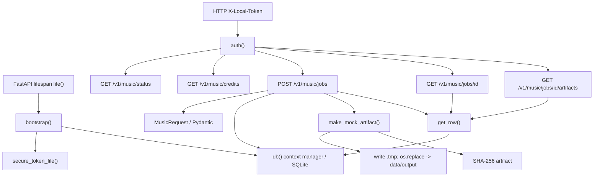
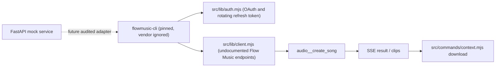
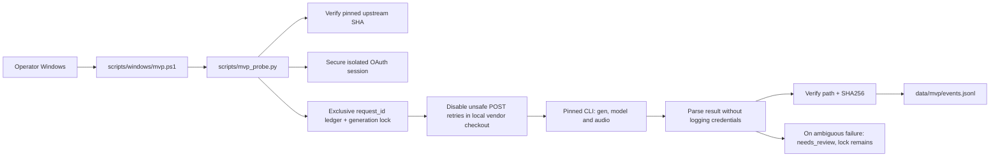
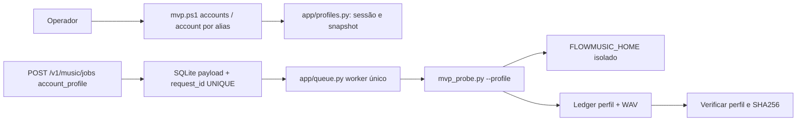

# Static CodeGraph — Evydencia FlowMusic Local

Audited target: `hypeneural/evydencia-flowmusic-local`, PR #1. This is a *manual static call/data graph* grounded in `app/main.py`, not an Antigravity IDE-indexed runtime graph. It is intentionally small so a lightweight model can trace exactly one call path at a time.

## States and transitions
- On request: validate payload + token -> atomic `INSERT OR IGNORE` on unique `request_id`.
- Same ID / same normalized payload -> original job (no re-generation).
- Same ID / different payload -> HTTP 409.
- Newly created mock -> `queued` -> `completed` with JSON artifact and SHA-256, or `failed` on filesystem error.
- Unsupported provider -> `auth_required` (does not contact Google).
- On bootstrap: `submitting`, `generating`, `downloading`, `validating` -> `needs_review`; NEVER replay an ambiguous remote POST.
- A concurrent caller might observe `queued` while a mock file is being written. Treat this as an intermediate state.

## Upstream boundary: opt-in API queue now integrated

The API delegates explicitly approved live jobs to `app/queue.py`, which launches `scripts/mvp_probe.py` once per job. It remains mock by default. See `docs/API_QUEUE.md`.

### Real MVP one-shot graph (separate process)

This graph is code structure, not observed authenticated execution. A successful CLI response alone does not prove platform compliance or professional audio quality. See `docs/MVP_RUNBOOK.md`.

## Change impact map
| Change | Inspect | Test |
|---|---|---|
| API request fields | MusicRequest, create() | validation, conflict, idempotency |
| Windows token ACL | bootstrap(), secure_token_file() | ACL startup failure, existing token; real icacls on Windows |
| SQLite state | db(), bootstrap(), create(), get_row() | temporary DB, restart, pending state |
| Mock output | make_mock_artifact(), create() | atomic file, SHA-256, disk failure |
| Real CLI integration | upstream auth/client/context; separate adapter PR | no live until permitted and specifically approved |
| IDE ergonomics | AGENTS.md, .agents/skills | confirm skill discovery in Antigravity |

## Exclusions and release gates
This static graph is not proof of live generation, performance, safety of reverse engineered endpoints, or permission to automate a consumer subscription. Review `docs/SECURITY.md` before changing the provider gate.

## Current FIFO queue (v0.2)
POST /v1/music/jobs -> SQLite UNIQUE(request_id) -> app/queue.py create_live -> claim (BEGIN IMMEDIATE, one submitting globally) -> mvp_probe -> local ledger + artifacts -> SHA256 verification -> completed or needs_review. A needs_review job blocks the queue until manual reconciliation; no automatic resubmission. See docs/API_QUEUE.md.

## Fluxo por conta (MVP)

A consulta de saldo não agenda nem executa músicas e a ordenação não altera o `account_profile` dos jobs.
